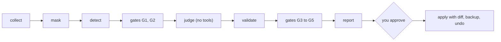

<p align="center"></p>

<p align="center"><b>Turn your repeated Claude Code corrections into rules, hooks and skills, only the ones you approve.</b></p>

<p align="center">
  <a href="LICENSE"></a>
  
  
  <a href="https://github.com/qjc-office/harness-creator/actions/workflows/ci.yml"></a>
</p>

<p align="center"><b>English</b> · <a href="README.ko.md">한국어</a> · <a href="README.zh.md">中文</a></p>

---

harness-creator is a Claude Code plugin that reads your own recent Claude Code sessions (and, if you agree, Codex sessions), finds repeated corrections, failure loops and repeated instructions, and proposes at most 3 rules, hooks or skills a week, each backed by quotes and session counts. Nothing is written until you approve a diff, every write is backed up, and `undo` restores it.

## 💡 Why

Asking a model "what should my harness contain?" gets you a long list. In early trials, only 1 of 11 suggestions was worth keeping: the rest were already resolved, inflated by one batch run, or too weakly supported to deserve a place in context that loads on every session.

So the model does not get the last word. Five gates filter the output, and most of them run as plain code, not as another prompt:

| Gate | What it removes |
|---|---|
| G1 | signals that were already resolved |
| G2 | counts inflated by a single batch run |
| G3 | issues that appeared only in Codex (moved to a reference section) |
| G4 | always-loaded rules with weak support |
| G5 | anything past the weekly limit of 3 candidates |

## ✨ Features

| | |
|---|---|
| Evidence first | every candidate carries quotes and session counts |
| Max 3 a week | fewer, better proposals |
| Masked at collection | secrets and personal data are masked before anything is stored or sent |
| Locked-down judge | no tools, no MCP servers, your settings, CLAUDE.md, skills, plugins and hooks off |
| Diff, backup, undo | writes only after you approve the diff; originals kept in `backups/` |
| Local only | no telemetry; the only network call is your own `claude` CLI |

## 🔧 How it works



1. First run asks for consent: which sessions are read, what is sent, how big, a rough collection time range (estimated at 1000 MB per minute, shown as N-2N min), and whether to include Codex. If you include Codex, masked Codex excerpts are also sent for judging to your `claude` CLI, that is, to Anthropic.
2. Collects the last 7 days, masks secrets and personal data at collection time, detects signals, and drops stale signals, batch-run inflation, Codex-only issues, weakly supported always-loaded rules, and anything past 3 candidates.
3. Sends masked excerpts once to your own `claude` CLI with no tools, no MCP servers, your settings ignored and your CLAUDE.md, skills, plugins and hooks off (`--restricted --safe-mode --tools ""`), from an empty temporary folder. Along with the excerpts it sends a masked list of your existing harness so the judge does not propose what you already have: names and descriptions of your rules, skills, agents, commands and installed plugins, hook script names, and up to 200 list lines from your memory index files (`MEMORY.md`). The consent screen says this too.
4. Shows candidates; you pick. Approved rules, skills and hooks are written to `~/.claude` after you see the diff. Memory, script and agent ideas are shown as drafts only.
5. The next analysis reports whether an applied harness's signal came back.

### How rules and skills are written

The frontmatter of a rule or skill is generated from a fixed set of keys: `name` (skill), `description`, `paths` (the globs you approved; none for an always-loaded rule) and, for files this plugin creates, `generated_by: harness-creator`, `generated_at` and `candidate_id`. This also applies when a candidate modifies a rule or skill you wrote yourself: that file gets no marker, but its frontmatter is regenerated with these keys and any other key it had is removed. The diff you approve shows exactly which lines go, and the original is kept in `backups/` so `undo` brings it back.

Look closely before approving a rule whose globs match almost everything (for example `**/*.*` or `@(**)`), or a skill whose `name` differs from its folder name; the skill asks you about both.

For hooks, `apply-plan` warns about network calls, `eval`, decode-and-run, writes outside your home folder and secret reads. These warnings come from a heuristic pattern check of the script text, not from running it: a clean result does not prove the hook is safe, so read the script yourself.

## 📦 Install

```
/plugin marketplace add qjc-office/harness-creator
/plugin install harness-creator@harness-creator
```

Then run `/harness-creator`. Requires Python 3.9+ and a Claude Code version whose `claude --help` lists `--restricted` and `--safe-mode`. Without them the plugin does not judge at all: the report's first line says a CLI upgrade is needed. There is no fallback that runs the judge without them. Supported on macOS and Linux; Windows is not supported.

## 🚀 Usage

| Command | What it does |
|---|---|
| `/harness-creator` | first run: consent, then analysis and candidates |
| `/harness-creator analyze` | run the analysis |
| `/harness-creator undo <id>` | restore an applied change from its backup |
| `/harness-creator forget` | delete collected data (scope below) |
| `/harness-creator where` | print the data folder |

## 🔒 Privacy and safety

Stored in the plugin data folder (or `~/.claude/harness-creator/`), folder 0700 and files 0600. Events, signals and judge input files are deleted after 30 days. The fallback folder gets a `.gitignore` containing `*`, so a `~/.claude` kept in git does not pick up collected data. No telemetry; the only network call is your `claude` CLI. `/harness-creator where` prints the folder.

`/harness-creator forget` deletes what was collected: `cursor.json` (the collection cursor), `collect-stats.json`, `events/`, `signals/`, `reports/`, `logs/`, and the apply plans and drafts in `plans/` and `drafts/`. It keeps `config.json` (your consent and settings), `decisions.jsonl` (a rejected signal stays quiet until it happens twice as often), `applied.jsonl` and `backups/` (so `undo` still works), and the `disabled` kill switch file if you created one.

To stop the plugin from running analysis, create an empty file named `disabled` in the data folder or set `HARNESS_CREATOR_DISABLED=1`.

## ⚙️ Configuration

`config.json` in the data folder. All keys are optional.

| key | meaning |
|---|---|
| `redact.lexicon_files` | extra word lists to mask (JSON list, or object of lists) |
| `redact.pattern_files` | extra regex files: `{"patterns": [{"label", "regex", "flags", "whole"}]}` |
| `run.wrap` | argv prefix for the heavy collection step (list of strings) |
| `judge.claude_bin` | path to `claude` (default: PATH) |
| `judge.model` | judging model (default `sonnet`) |
| `judge.timeout_s` | judging time limit in seconds (default 1800). Must be a positive integer; `null`, `0`, strings and decimals are rejected as a config error |
| `sources.codex` | include Codex sessions (set by consent) |
| `lang` | report language `ko`, `zh` or `en` (default: majority of your messages) |
| `include` | other config files merged before this one. Use absolute paths; a relative path is resolved against whatever folder the command runs from |

If a configured file cannot be read, collection stops instead of continuing unmasked.

## ⚠️ Limits

### What masking misses

Masking is a set of regular expressions plus your own word lists. It does not catch everything. Known misses:

- passwords shorter than 8 characters that have no key name in front of them
- credentials inside URLs (`user:pw@host`)
- Korean and Chinese mobile numbers separated by dots (`010.2222.3333`)
- `KEY=value` assignments whose key name is longer than 64 characters
- doubly escaped JSON (`{\\"password\\": ...}`)
- YAML block values (`password: |` followed by the value on the next line)
- one-letter flags with the value attached (`-p<value>`)
- flag values that start with `-` (`--password -abc...`)
- XML elements (`<password>...</password>`)
- `Authorization: Basic` headers
- a quoted value that contains an unescaped quote of the same kind (`password***MASKED***efgh"`): masking stops at that inner quote and the rest of the value stays visible
- a value that straddles the end boundary of a single message longer than 64KB can leave its leading part visible
- proper nouns (customer, project or person names) that are not in a word list

Add your own word lists with `redact.lexicon_files` and your own regexes with `redact.pattern_files`. Both are fail-closed: a listed file that cannot be read stops collection.

### Detection accuracy

Chinese and English correction patterns have been checked only against synthetic samples, so their accuracy has not been measured. For the first two weeks, read each candidate yourself and reject the ones that do not match what happened. A rejected signal is not proposed again until it happens twice as often.

## ❓ FAQ

**Does it change my files without asking?** No. Rules, skills and hooks are written only after you approve the diff. Memory, script and agent ideas are drafts.

**Can I undo a change?** Yes: `/harness-creator undo <id>`. Originals are kept in `backups/`, and `forget` does not delete them.

**What leaves my machine?** Masked excerpts and a masked list of your existing harness go to your own `claude` CLI, that is, to Anthropic. With Codex included, masked Codex excerpts go the same way. Nothing else is sent.

**How do I turn it off?** Create an empty `disabled` file in the data folder or set `HARNESS_CREATOR_DISABLED=1`.

**How do I remove it?** Undo applied harnesses with `/harness-creator undo <id>`, then `/plugin uninstall harness-creator`.

## 📄 License

MIT. Copyright QJC (Quantum Jump Club).

---

<sub>Unofficial community plugin. Not affiliated with, endorsed by, or sponsored by Anthropic. The Anthropic logo and Claude are trademarks of Anthropic, PBC.</sub>
