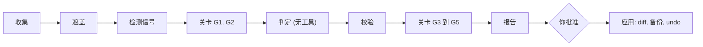

<p align="center"></p>

<p align="center"><b>把你反复对 Claude Code 做的纠正变成规则、钩子和技能,只应用你批准的部分。</b></p>

<p align="center">
  <a href="LICENSE"></a>
  
  
  <a href="https://github.com/qjc-office/harness-creator/actions/workflows/ci.yml"></a>
</p>

<p align="center"><a href="README.md">English</a> · <a href="README.ko.md">한국어</a> · <b>中文</b></p>

---

harness-creator 是一个 Claude Code 插件: 读取你自己最近的 Claude Code 会话 (经你同意也包括 Codex 会话), 找出反复纠正、失败循环和重复指令, 每周最多提出 3 个有引用和会话数作为依据的规则、钩子或技能候选。在你批准 diff 之前不写入任何内容, 每次写入都有备份, 可用 `undo` 恢复。

## 💡 为什么做这个

直接问模型"我的 harness 里该有什么", 会得到一长串建议。早期试用中, 11 条建议只有 1 条值得保留: 其余的要么已经解决, 要么被一次批量运行放大, 要么依据太弱, 不配放进每次会话都会加载的上下文。

所以最终判断不交给模型。五道关卡过滤结果, 其中大部分是普通代码, 而不是再来一个提示词。

| 关卡 | 过滤掉什么 |
|---|---|
| G1 | 已经解决的信号 |
| G2 | 被一次批量运行放大的次数 |
| G3 | 只在 Codex 中出现的问题 (移到参考部分) |
| G4 | 依据不足的常驻规则 |
| G5 | 超过每周 3 个上限的候选 |

## ✨ 主要功能

| | |
|---|---|
| 依据优先 | 每个候选都带有引用和会话数 |
| 每周最多 3 个 | 数量少, 但质量高 |
| 收集时遮盖 | 机密和个人信息在存储或发送之前就被遮盖 |
| 锁定的判定器 | 无工具、无 MCP 服务器, 关闭你的设置、CLAUDE.md、技能、插件和钩子 |
| diff、备份、undo | 批准 diff 后才写入, 原文件保存在 `backups/` |
| 仅本地 | 没有遥测, 唯一的网络调用是你自己的 `claude` CLI |

## 🔧 工作方式



1. 首次运行时请求同意: 读取哪些会话、发送什么、多大、预计收集时间范围 (按每分钟 1000 MB 估算, 显示为 N~2N 分钟), 以及是否包含 Codex。如果包含 Codex, 遮盖后的 Codex 会话摘录也会通过你的 `claude` CLI 发送给 Anthropic 进行判定。
2. 收集最近 7 天, 在收集时遮盖机密和个人信息并检测信号。已解决的信号、批量运行造成的虚高、仅 Codex 的问题、依据不足的常驻规则以及超过 3 个的候选会被代码过滤。
3. 把遮盖后的摘录发送一次到你自己的 `claude` CLI, 不提供任何工具和 MCP 服务器, 忽略你的设置, 并关闭 CLAUDE.md、技能、插件和钩子 (`--restricted --safe-mode --tools ""`), 在空的临时目录中运行。除摘录外, 还会发送遮盖后的现有 harness 清单, 避免重复提议你已有的内容: 规则、技能、代理、命令和已安装插件的名称与描述, 钩子脚本名, 以及记忆索引文件 (`MEMORY.md`) 中最多 200 行列表。同意界面也会说明这一点。
4. 展示候选由你选择。批准的规则、技能和钩子在你看过 diff 后写入 `~/.claude`。记忆、脚本和代理只给出草稿。
5. 下一次分析会报告已应用项的信号是否再次出现。

### 规则和技能的写入方式

规则和技能的 frontmatter 只用固定的键重新生成: `name` (技能)、`description`、`paths` (你批准的 glob, 常驻规则没有) , 以及本插件创建的文件才有的 `generated_by: harness-creator`、`generated_at`、`candidate_id`。候选修改你自己写的规则或技能时也是如此: 该文件不加标记, 但 frontmatter 会用这些键重新生成, 原有的其他键会被删除。你批准的 diff 会显示删掉了哪些行, 原文件保存在 `backups/`, 可用 `undo` 恢复。

对 glob 几乎匹配所有文件的规则 (如 `**/*.*`、`@(**)`) 或 `name` 与文件夹名不同的技能, 批准前请仔细查看; 技能会在提问时特别指出这两种情况。

对于钩子, `apply-plan` 会警告网络调用、`eval`、解码后执行、写入主目录之外以及读取机密。这些警告是对脚本文本的启发式模式检查, 不是实际运行的结果。没有警告并不代表安全, 请自己阅读脚本。

## 📦 安装

```
/plugin marketplace add qjc-office/harness-creator
/plugin install harness-creator@harness-creator
```

然后运行 `/harness-creator`。需要 Python 3.9+, 以及 `claude --help` 中包含 `--restricted` 和 `--safe-mode` 的 Claude Code 版本。缺少其中任何一个时插件完全不做判定, 报告第一行会提示需要升级 CLI。不存在去掉该参数运行判定的替代路径。支持 macOS 和 Linux, 不支持 Windows。

## 🚀 用法

| 命令 | 作用 |
|---|---|
| `/harness-creator` | 首次运行先请求同意, 然后分析并给出候选 |
| `/harness-creator analyze` | 运行分析 |
| `/harness-creator undo <id>` | 从备份恢复已应用的更改 |
| `/harness-creator forget` | 删除已收集的数据 (范围见下) |
| `/harness-creator where` | 打印数据目录位置 |

## 🔒 隐私与安全

保存在插件数据目录 (或 `~/.claude/harness-creator/`), 目录 0700, 文件 0600, 事件、信号和判定输入文件 30 天后删除。备用目录中会创建内容为 `*` 的 `.gitignore`, 用 git 管理 `~/.claude` 时不会混入收集的数据。没有遥测, 唯一的网络调用是你的 `claude` CLI。用 `/harness-creator where` 查看目录位置。

`/harness-creator forget` 删除已收集的数据: `cursor.json` (收集游标)、`collect-stats.json`、`events/`、`signals/`、`reports/`、`logs/`, 以及存放应用计划和草稿的 `plans/`、`drafts/`。保留 `config.json` (你的同意和设置)、`decisions.jsonl` (被拒绝的信号在出现次数翻倍之前不会再次提出)、`applied.jsonl` 和 `backups/` (`undo` 需要), 以及你创建的 `disabled` 停用开关文件。

要停止分析, 在数据目录中创建空文件 `disabled`, 或设置 `HARNESS_CREATOR_DISABLED=1`。

## ⚙️ 配置

数据目录中的 `config.json`, 所有键都是可选的。

| 键 | 含义 |
|---|---|
| `redact.lexicon_files` | 额外要遮盖的词表文件 (JSON 列表, 或包含列表的对象) |
| `redact.pattern_files` | 额外的正则文件: `{"patterns": [{"label", "regex", "flags", "whole"}]}` |
| `run.wrap` | 包裹耗时收集步骤的 argv 前缀 (字符串列表) |
| `judge.claude_bin` | `claude` 路径 (默认: PATH) |
| `judge.model` | 判定模型 (默认 `sonnet`) |
| `judge.timeout_s` | 判定时间上限 (秒, 默认 1800)。必须是正整数; `null`、`0`、字符串和小数都会作为配置错误停止 |
| `sources.codex` | 是否包含 Codex 会话 (由同意步骤设置) |
| `lang` | 报告语言 `ko`、`zh` 或 `en` (默认: 你消息中的多数语言) |
| `include` | 在本文件之前合并的其他配置文件。请使用绝对路径; 相对路径会按执行命令时所在的目录解析 |

指定的文件无法读取时会停止收集, 不会在未遮盖的情况下继续。

## ⚠️ 限制

### 遮盖会漏掉的内容

遮盖基于正则表达式和你自己的词表, 无法覆盖一切。已知漏掉的形式:

- 前面没有键名、少于 8 个字符的密码
- URL 中的账号信息 (`user:pw@host`)
- 用点分隔的韩国和中国手机号 (`138.0000.0000`)
- 键名超过 64 个字符的 `KEY=值` 赋值
- 双重转义的 JSON (`{\\"password\\": ...}`)
- YAML 块值 (`password: |` 之后下一行的值)
- 值紧跟在单字母参数后 (`-p<值>`)
- 以 `-` 开头的参数值 (`--password -abc...`)
- XML 元素 (`<password>...</password>`)
- `Authorization: Basic` 请求头
- 值中含有未转义的引号且与外层引号同类 (`password***MASKED***efgh"`): 遮盖在内层引号处停止, 值的其余部分仍然可见
- 跨越超过 64KB 的单条消息末尾边界的值, 其前半部分可能保持可见
- 不在词表中的专有名词 (客户、项目或人名)

可以用 `redact.lexicon_files` 补充词表, 用 `redact.pattern_files` 补充正则。两者都会在指定文件无法读取时停止收集。

### 检测准确度

中文和英文的纠正模式只用合成样本检查过, 实际准确度尚未测量。前两周请亲自阅读每个候选, 拒绝与实际情况不符的候选; 被拒绝的信号在出现次数翻倍之前不会再次提出。

## ❓ 常见问题

**它会不经询问就改我的文件吗?** 不会。规则、技能和钩子只在你批准 diff 之后写入, 记忆、脚本和代理只给出草稿。

**能撤销吗?** 可以, 用 `/harness-creator undo <id>`。原文件保存在 `backups/`, `forget` 也不会删除它。

**哪些内容会离开我的电脑?** 遮盖后的摘录和遮盖后的现有 harness 清单会发送到你自己的 `claude` CLI, 也就是发送给 Anthropic。包含 Codex 时, 遮盖后的 Codex 摘录走同一条路径。除此之外不发送任何内容。

**怎么关闭?** 在数据目录中创建空文件 `disabled`, 或设置 `HARNESS_CREATOR_DISABLED=1`。

**怎么卸载?** 先用 `/harness-creator undo <id>` 撤销已应用项, 再执行 `/plugin uninstall harness-creator`。

## 📄 许可证

MIT。Copyright QJC (Quantum Jump Club)。

---

<sub>非官方社区插件。与 Anthropic 无关联, 未获 Anthropic 认可或赞助。Anthropic 标志和 Claude 是 Anthropic, PBC 的商标。</sub>
